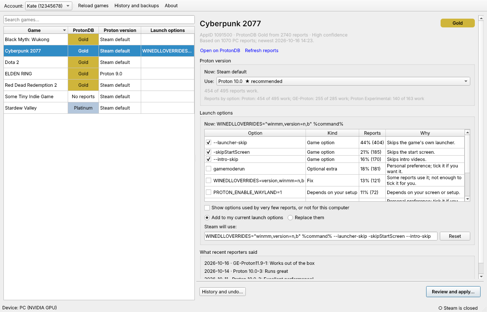

# autoproton

Pick the best Proton version and launch options for your Steam games from
[ProtonDB](https://www.protondb.com) reports, and apply them to Steam safely,
with a backup you can undo.



For each installed game, autoproton reads every ProtonDB report and works
out:

- **which Proton to use**: native Linux version, official Proton, Proton
  Experimental or GE-Proton, and which release;
- **which launch options help**: fixes and game options that many working
  reports use (`--launcher-skip`, `WINEDLLOVERRIDES=…`, `-sdlaudiodriver pulse`).
  Personal extras like `gamemoderun`, MangoHud, HDR or Wayland are offered
  but never switched on for you.

You see the evidence (how many reports use each thing), tick what you want,
review the exact before and after, and apply. Steam is closed for you if
needed, and every change can be undone from **History**.

## Download and run

1. Download `autoproton-<version>-x86_64.AppImage` from the
   [Releases page](https://github.com/gamesensicals/autoproton/releases)
   (or the latest build under **Actions → Test and build AppImage →
   Artifacts**).
2. Make it executable: right-click → Properties → "Allow executing as program",
   or `chmod +x autoproton-*.AppImage`.
3. Double-click it.

It runs on any 64-bit Linux distribution from about 2022 onwards (glibc 2.35
or newer): Ubuntu 22.04+, Debian 12+, Fedora, Arch, openSUSE, Linux Mint,
Pop!_OS and **SteamOS**. Nothing to install. Windows and macOS aren't
supported, because Proton only exists on Linux.

**Steam Deck:** switch to Desktop Mode (Steam button → Power → Switch to
Desktop), download the AppImage, and run it from the file manager. Steam
runs the whole Game Mode session, so autoproton can't save from there.

## How it decides

- **Your kind of device first.** Steam Deck owners get Steam Deck reports
  and PC owners get PC reports. If there are too few, all reports are used,
  with the other kind counting for less.
- **Recent reports count more** (a report loses half its weight every nine
  months or so). Reports from people with the same GPU brand count a bit
  more, and reports that list problems count less.
- **Proton version:** each option gets a score that is the lower end of a
  confidence range on its success rate. That way three glowing reports
  can't outvote three hundred good ones. When options are about equal, it
  keeps what you already use, then prefers native, then official Proton,
  then Experimental, then GE-Proton.
- **Launch options:** a fix or game option is ticked when at least 15% of
  working reports (and at least 3) use it. Options that a report needed
  because the game didn't work out of the box count extra. Options that are
  just as common in failing reports aren't ticked.
- **Safety:** launch options come from strangers and Steam runs them through
  a shell. autoproton only offers known helper programs (and only if they're
  installed). It drops anything containing shell syntax, file paths, or
  variables like `LD_PRELOAD`. Your own existing options are kept exactly as
  you typed them.

## What it changes, and how to undo

autoproton changes two things per game, and nothing else:

| Setting | Stored in |
|---|---|
| Launch options | `~/.steam/steam/userdata/<account>/config/localconfig.vdf` |
| Forced compatibility tool | `~/.steam/steam/config/config.vdf` (`CompatToolMapping`) |

- Steam must be closed while saving, because it rewrites these files when it
  exits. autoproton offers to close it, and can start it again afterwards.
- Only the exact bytes of those settings change. The rest of each file stays
  byte-for-byte identical.
- Before every change, both files are backed up to
  `~/.local/share/autoproton/backups/`. The first backup of each file is kept
  forever.
- **History** lists every change. **Undo** puts back what Steam had before,
  **Use these settings again** re-applies an older change, and you can mark
  changes as working or not.
- If the window ever won't open, the same AppImage works from a terminal:

  ```bash
  ./autoproton-*.AppImage --cli history 1091500     # what changed for a game
  ./autoproton-*.AppImage --cli revert 1091500      # undo the latest change
  ./autoproton-*.AppImage --cli revert 1091500 --last-good   # back to one marked as working
  ./autoproton-*.AppImage --cli backups             # whole-file backups
  ./autoproton-*.AppImage --cli restore-file <id>   # put a whole file back
  ./autoproton-*.AppImage --cli --help              # everything else (recommend, apply, …)
  ```

## GE-Proton

If GE-Proton works best for a game and isn't installed, autoproton asks
before downloading it. It fetches the latest release from
[GloriousEggroll/proton-ge-custom](https://github.com/GloriousEggroll/proton-ge-custom/releases),
checks it against the published SHA-512 checksum, unpacks it safely and
installs it to `compatibilitytools.d`. Undoing a change never deletes a
GE-Proton version, because another game may use it.

## Settings and troubleshooting

| Situation | What to do |
|---|---|
| "Steam wasn't found" | Start Steam once. For an unusual location, run with `AUTOPROTON_STEAM_ROOT=/path/to/Steam`. Flatpak and Snap Steam are found automatically. |
| Wrong device or GPU detected | `AUTOPROTON_DEVICE=deck` or `pc`, `AUTOPROTON_GPU=nvidia`, `amd` or `intel` |
| The AppImage won't start: "FUSE" or "dlopen" error | Run it with `--appimage-extract-and-run`. |
| The window doesn't open | Run `./autoproton-*.AppImage --self-test` and include the output in a bug report. The log is at `~/.local/state/autoproton/autoproton.log`. |
| Several Steam accounts | Pick one in the toolbar. Launch options are per account; the Proton version is per Steam install. |

ProtonDB answers are cached for a day in `~/.cache/autoproton`. Use **Refresh
reports** to fetch fresh ones.

## Building from source

```bash
git clone https://github.com/gamesensicals/autoproton
cd autoproton
python3 -m venv .venv
.venv/bin/pip install -e '.[dev]'
.venv/bin/autoproton                     # run the app
QT_QPA_PLATFORM=offscreen .venv/bin/pytest   # run the tests
PYTHON=.venv/bin/python packaging/build_appimage.sh   # build dist/autoproton-*.AppImage
```

Python 3.10 or newer. Qt needs a few system libraries, which any desktop
already has. On a bare Debian or Ubuntu, install them with
`sudo apt install libegl1 libxkbcommon-x11-0 libxcb-cursor0 libglib2.0-0`.
Build the AppImage on the oldest distribution you want to support, because it
needs at least the glibc it was built with. CI builds on Ubuntu 22.04.

The code is laid out as:

- `src/autoproton/steam/`: reading and editing Steam's files
- `protondb/`: ProtonDB client
- `recommend/`: the decision logic
- `transaction.py`, `backup.py`, `history.py`: safe writes and undo
- `gui/`: the window
- `cli.py`: the terminal interface

The core never imports Qt.

`docs/MANUAL_TEST.md` is the checklist for testing on a real Steam install.
`docs/PLAN.md` is the design.

## Limitations

- ProtonDB has no official API. autoproton reads the same per-game report
  file ProtonDB's website loads. If ProtonDB changes how that works,
  autoproton says so clearly, still shows the rating, and needs an update.
- Steam's internal names for official Proton versions (`proton_10`,
  `proton_9`, …) follow a pattern rather than a documented list. When a
  forced official version isn't installed yet, Steam is expected to
  download it the first time the game starts. Both are on the manual test
  checklist.

## Credits

Ratings and reports come from [ProtonDB](https://www.protondb.com). ProtonDB
data is available under the
[Open Database License](https://opendatacommons.org/licenses/odbl/1-0/), with
individual contents under the
[Database Contents License](https://opendatacommons.org/licenses/dbcl/1-0/).
autoproton isn't affiliated with ProtonDB, Valve or GloriousEggroll.

MIT licensed. See `LICENSE`.
